# HairGenVulkan - the hair-mesh demo as a native Vulkan / C++ application

A from-scratch native renderer that reproduces the look and the controls of the
`HairGen` WebGL demo (Cem Yuksel's *hair mesh* renderer, `../hairmesh.js` +
`../shaders.js`), written in C++17 on raw Vulkan with **no SDK and no
dependencies beyond a C++ compiler** - the Vulkan entry points are resolved at
runtime and the shaders are pre-compiled to SPIR-V and embedded in the binary.

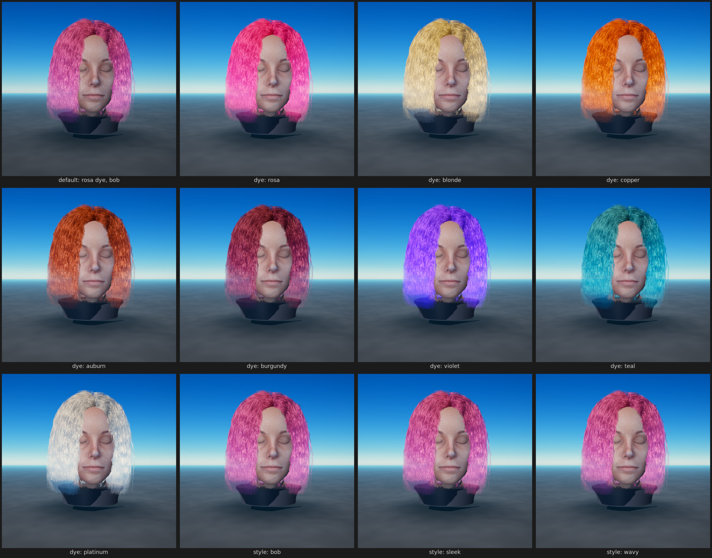

| | |
|---|---|
| 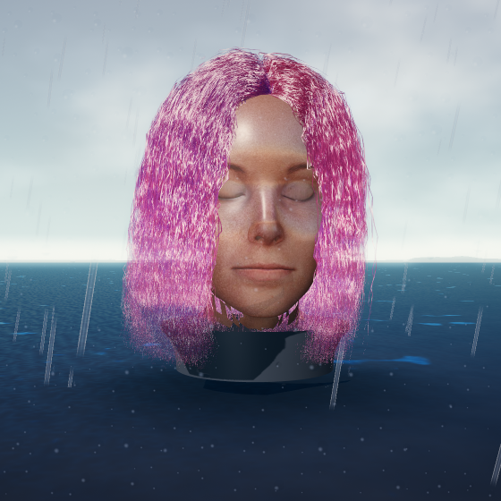 | 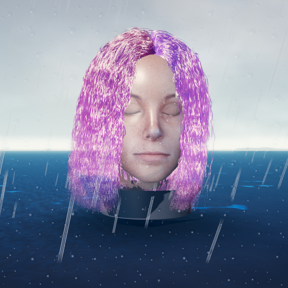 |

`media/weather_sheet.jpg` walks the whole weather system (dry, drizzle, rain,
storm, sunset, noon, flooded puddles, wet close-up) and `media/rain.gif` /
`media/rain.webp` / `media/rain.avi` are an animated clip of it.

| | |
|---|---|
| 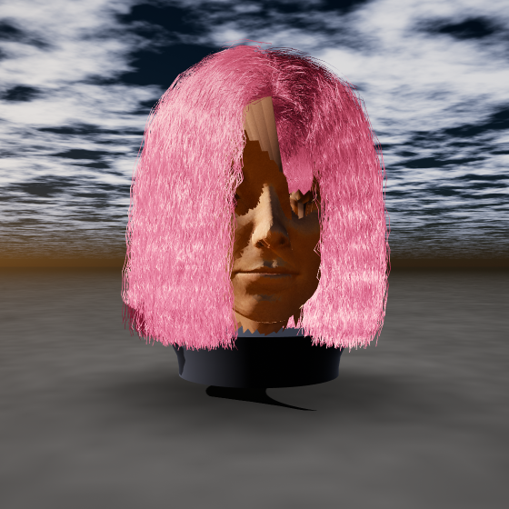 | 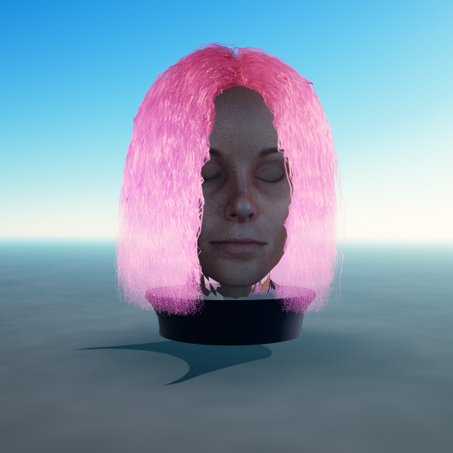 |

Everything in the frame is GPU work: 10 000 hair strands × 32 segments
(637 836 triangles) rendered as screen-space ribbons, shaded with a Marschner
fiber BSDF that reads the demo's precomputed `N_TT_R / N_TRT / GI / M_GI` lookup
tables, against a physically based sky that is re-baked into an equirectangular
HDR table every frame and then used for both the background and the IBL.

---

## Build

```sh
cd HairGenVulkan
meson setup build --buildtype=release
ninja -C build
./build/hairgen --out render.png --size 768
```

`./setup.sh` does exactly that (and `./setup.sh --capture` also renders the
media below). A plain `Makefile` and a `CMakeLists.txt` are provided as
fallbacks for environments without meson.

Requirements: a C++17 compiler, meson ≥ 0.60, ninja. **No Vulkan SDK** - the
loader is `dlopen`ed and the headers are vendored in `third_party/vulkan`; any
ICD (a real GPU driver, SwiftShader or lavapipe) will do. On a headless box:

```sh
VK_ICD_FILENAMES=/path/to/lvp_icd.json ./build/hairgen --out render.png --size 512
```

The asset bundle (`assets/hairgen_assets.bin`, 4.5 MB) is checked in so the
build is self-contained. It is produced from the web demo's own data by
`node tools/export_assets.js` (`ninja -C build assets`), which re-implements the
demo's hair-mesh 3D-texture / clump-map generation on the CPU.

## Features

**Hair (the point of the demo).** The full hair-mesh pipeline is ported:
topology → 7×6×13 three-channel hair-mesh volume, 22 bundle roots, per-instance
jitter, clump targets from a 256² clump-centre map, kink / curl / frizz / fuzz
displacement in the hair-mesh surface frame, ribbon expansion in screen space
and a length-variation cut-off.

**Pink by default.** The start-up look is the supplied **rosa** LUT set (not
blond): `materials/rosa/*` are re-derived on export so they keep the blond
tables' per-texel luminance -- their scattering structure -- and take only their
chroma from the supplied set. The supplied rosa PNGs are ~5x brighter in N_TRT
than the blond ones; using them raw swamped the R and TT lobes and flattened the
whole head into one pink mass. Blond is still one dropdown away.

**Hair dye.** The fibre lookup tables bake in one hair colour, so a dye is a
*chromatic* remap of the scattered radiance: the target colour is normalised by
its brightest channel (absorption semantics - a dye can only subtract light) and
the fibre's luminance is redistributed into that hue, with the specular bands
kept partly white. Per-strand jitter and a root→tip ramp then give the mass
depth instead of a flat wig - the ramp is that project's `MIN_COLOR` formula
with its own constants (`MIN_COLOR = 0.5`, `MAX_COLOR_START = 0.3`), declared at
the top of `hair.frag` so the file can be diffed against `constants.glsl`
instead of merely resembling it. `HAIR_SHININESS` is likewise the source's 50,
not a retuned value.
A Kajiya-Kay wrap-diffuse + tight highlight pair (`sqrt(1-|T·L|)`,
`pow(sqrt(1-|T·H|), HAIR_SHININESS)`, both from `mravella/hair`) is added on top of the
Marschner tables so the fibres keep a glossy band, and a cool **fill light**
(`FILL_LIGHT_POS`, also from that project) keeps the shadow half of the head
from collapsing into a silhouette.

The palette is 39 named colours plus any `#RRGGBB`, laid out in the panel as
*Natural* (jet → platinum, ginger → wine) and *Fashion* (rosa, violet, teal,
emerald, sunset, …); `--list-dyes` prints them. The start-up look is **rosa**,
and the default dye triple is now the palette entry converted to linear, so the
hex in the panel, the lit-up swatch and the render finally agree (they used to
be three different pinks).

**Ombre, balayage, dip dye.** The dye is a *pair* of colours plus a gradient:
`dye` at the root, `dye_tip` at the ends, and `dye_gradient` controlling where
the tip colour takes over. `0` is a flat dye, `0.75` a soft ombre, `1.0` a
balayage that saturates at the tips, and anything above `1` a hard dip-dye band
(`1.6` covers the last ~60 % of the strand). The blend happens per fragment from
the strand parameter, so it follows the cut, not screen space. The panel has
one-click **Flat / Ombre / Balayage / Dip dye** buttons that derive the tip
colour from the root, and `--dye-tip` / `--dye-gradient` do the same from the
shell.

**Hairstyles: 26 presets, male and female.** One guide mesh, and every style is
a full set of fuzz / frizz / kink / clump / curl operator values - the "author
many styles from one hair mesh by stacking procedural operators" idea from the
SIGGRAPH'24 hair-mesh paper - plus two silhouette controls added here, because
operators alone cannot turn a long style into a short one:

* `cut_length` (0.15–1) truncates every strand along its own parameter, so a
  buzz cut, a crew cut and a bob are the same mesh cut at different points;
* `volume` (0–1) lifts the mass radially off the skull, which is what separates
  an afro or a pompadour from a slick back.

| long / female | | short / male | |
|---|---|---|---|
| `bob` `lob` `layered` | `wavy` `curls` `coils` | `buzz` `crew` `fade` | `side_part` `quiff` `pompadour` |
| `sleek` `long` `pixie` | `fringe` `volume` `editorial` | `textured` `slick_back` `curly_top` | `mohawk` |
| unisex: | `afro` `shag` `punk` `wet_look` | | |

`--list-styles` prints the table with each preset's cut length, volume and
suggested dye; the panel's **Styles** window shows them as a gallery with
gender icons, a group filter, per-style tooltips and a highlight on the active
style. Switching style intentionally leaves the dye alone.

**Artifact fixes on the scanned bust.** The head is a torn, overlapping
triangle strip, and most of what looked ugly came from that:
normal orientation is now solved per *connected region* (BFS over the welded
edge graph, one global sign), inward normals are repaired against a fitted head
ellipsoid, the normal field is smoothed both over the mesh graph and
*spatially* (a small world-space blur, so co-located sheets of the fold agree
instead of shading as a hard seam), zero-length normals are repaired (they
normalised to NaN and rendered as black wedges), and the head no longer casts a
self-shadow. On the shading side the diffuse uses a wide wrap term, the scalp is
darkened under the hair, and UVs are mirrored back into the island instead of
`fract()`-wrapped (wrapping sampled the far side of the photo, which drew a
tonal seam down the face).

**Artifact fixes on the hair.** The strand pipeline hid a handful of real defects that
between them made the hair look flat and occasionally exploded:

* **The hair shadow map was empty.** In the shadow pass the ribbon was never
  expanded, so every strand collapsed to a zero-area quad and wrote no depth.
  Nothing self-shadowed, the mass rendered fully lit from every angle, and the
  floor never received a hair shadow - the single biggest reason the render did
  not look like the reference. The shadow pass now widens the ribbon in light
  space (`kShadowWidth`), which is all the Beer-Lambert lookup needs.
* **The second ribbon vertex used the first vertex's clump delta**
  (`p2 += cDiff` instead of `cDiff2`), which bent every ribbon segment.
* **Division by a zero-length delta.** With the demo's default `clumpSize = 0`
  the clump factor was `0/0` → NaN → black shards across the frame. Both lengths
  are clamped, and the root frame (`uDir`/`vDir` cross product) is sanitised, as
  is a degenerate tangent (a NaN tangent used to erase whole ribbons).
* **The material's absorption was ignored in the shadow model**, which hard-coded
  the blond constants: a rosa render kept a blond shadow tint. The shadow now
  reads `frame.fiber`.
* The shadow lookup (~45 taps) was evaluated twice per fragment; the direct
  fraction is handed back from `ShadeHair()` instead.
* `--hair-count` (and the panel's strand slider) did nothing on a live render:
  `set_scene()` compared the request against the *per-bundle* count and the test
  could never be true. It now compares against the values the geometry was
  actually built with.

**High-quality output.** The tonemapper is the reference ACES fit (RRT+ODT, with
the ACEScg input/output matrices) rather than the Narkowicz approximation, so a
pink or blond highlight keeps its chroma instead of bleaching to white; the
8-bit dither is triangular, which removes the sky banding at half the amplitude,
and MSAA is combined with alpha-to-coverage on the ribbons so the silhouette
dissolves into fibres instead of a polygon edge.

**Skin detail.** The supplied head maps (`normal`, `height`, `ao`, `specular`)
are wired into `head.frag`: a TBN built from UV gradients (the mesh carries no
tangents), a mipmapped tangent-space detail normal, an AO mask that attenuates
ambient + fill, and a specular mask. The raw normal map is one texel of pore
noise over a smooth base, so the exporter derives the shipped normal from the
(clean) height field - high-passed so the big relief is not shaded twice - and
folds in a prefiltered quarter of the original for micro-detail.

**Shading.** Marschner fiber model with the demo's LUTs (`N_TT_R`, `N_TRT`,
`N_TT_R_GI`, `N_TRT_GI`, `GI`, `M_GI`), a multiple-scattering hair shadow model
(Beer-Lambert through a hair depth map, which is what makes blond hair glow when
back-lit) and a Marschner-consistent sky ambient term. The head uses the demo's
skin albedo with wrapped diffuse, GGX specular and hair-shadow transmittance.

**Unreal's Hair shading model, ported.** Unreal documents its **Hair** shading
model as *"simulating multiple specular highlights: one representing the color
of light, and another representing a mix of hair and light color"*, with the
inputs **Base Color, Scatter, Specular, Roughness, Tangent, Backlit** (plus
emissive, AO, world/pixel offset, which do not apply here):

| UE Hair input | here | notes |
|---|---|---|
| Base Color | `--dye` / the fibre LUTs | UE tints the same Marschner lobes; we tint the scattered radiance (see *Hair dye*) |
| Tangent | the per-strand ribbon tangent | hair is shaded *around the tangent*, never around a normal |
| Scatter | `--scatter` (0.65) | weight of the dual-scattering / GI term; UE's artistic range is 0.5–0.8 |
| Specular | `--specular` (0.55) | scale of the **light-coloured** highlight lobe; the fibre-tinted lobe is separate, which is exactly the two-lobe description above |
| Roughness | `--roughness` (0.40) | one control mapped monotonically onto the R / TT / TRT longitudinal deviations (0.4 reproduces the demo's material); UE suggests 0.3–0.5, and widening the lobe instead of dimming it is what stops hair reading as plastic |
| Backlit | `--backlit` (0.06) | transmission through strands lit from behind, weighted by how edge-on the fibre is to the light |

Base Colour and Tangent already existed, so a groom material now ports over as
four numbers plus the dye. **`--stylise`** (0.45) is the one control UE has no
equivalent for: the demo's extra radiance lift, rim, sheen and the 1.30×
saturation boost are "makeup" that a physical model does not have, so they are
scaled by it - 0 gives the plain physical result, 1 the original web look.

Where Unreal's *groom pipeline* goes further, and what this renderer does
instead - stated rather than glossed over:

* UE **voxelizes** the groom into a density volume and computes shadow and
  transmittance by ray-marching that volume, with **Deep Shadow** lights using a
  four-layer deep opacity map (per CVar `r.HairStrands.DeepShadow.*`). We have no
  groom to voxelize: the strands are generated on the GPU from the demo's
  hair-mesh volume, so there is no CPU-side curve data to build a density volume
  from. Transmittance therefore stays the demo's Beer–Lambert model over a hair
  depth map, filtered with a 3×3 tent - a single-layer deep opacity map.
* UE composites hair *samples* and can supersample groom visibility to 8 samples
  per pixel. This renderer now defaults to **8× MSAA plus 2× supersampling**
  (`--samples`, `--ssaa`) and derives alpha from the strand's projected width,
  which is the same idea with fewer moving parts.

**That dithering on the hair edge.** It was two separate things, and both are
gone:

* the tonemapper's dither used a `fract(sin(dot(...)))` hash, which decorrelates
  every pixel from its neighbours - i.e. static grain, most visible on smooth
  gradients and on the silhouette. It is now **interleaved gradient noise**
  (Jimenez 2014, the sequence Unreal uses for temporally stable dithering),
  still triangular and still exactly ±0.5 LSB;
* the silhouette itself stippled because every sub-pixel ribbon fragment asked
  for **full** alpha-to-coverage, and the hardware can only grant k/4 of a
  pixel at 4× MSAA. Alpha is now the *fraction of the pixel the strand covers*,
  computed from the ribbon's projected width in pixels, faded to zero over the
  last 1.5 % of the strand instead of ending on a full-alpha quad. A 0.4-pixel
  strand is now 40 % transparent instead of a coin flip.

**Lighting & shadows.** Two 1 k² shadow maps per frame (object depth + hair
depth for the transmittance model), image-based ambient from the sky table, sun
disc, and an infinite ground plane that catches the ground shadow.

**Studio checkerboard floor.** The floor under the bust is an analytic
checkerboard (`ground.frag`) - no texture, so it is sharp at any distance, which
also means it has to filter itself: the pattern is a box filter of the square
wave (`0.5 - 0.5·tri(px)·tri(py)`, i.e. the classic "integrated checker"), so
the squares stay square up close and dissolve into flat 50 % grey exactly where
they would start to moiré, with no mip chain and no LOD bias. Square size, edge
fade distance and both square colours are exposed (`--checker`,
`--checker-scale`, `--checker-fade`, and the panel's *Ground* window), puddles
eat into the pattern where water stands, and the checker is *albedo* - shadows,
wetness and the sky bounce all still apply on top of it. Default: on, 1.6
squares per world unit, dissolving at 7 m.

**Sky: Preetham 1999.** The atmosphere is the analytic daylight model from
Preetham, Shirley & Smits -- the same model three.js' `Sky.js` ships, ported to
GLSL here (`shaders/lib/sky_model.glsl`): measured Rayleigh/Mie coefficients at
680/550/450 nm, the `1/(cos θ + 0.15·(93.885 − θ)^−1.253)` optical path, the
solar-zenith intensity curve with its earth-shadow cutoff, Rayleigh and
Henyey-Greenstein phase functions. Because the radiance is physically scaled,
the zenith goes blue, the horizon warms and a low sun reddens on its own; there
is no hand-graded ramp. The table is baked at 256×128 and drives both the
visible background and the IBL probe, with `--turbidity`, `--rayleigh`, `--mie`
and `--mie-g` exposed.

On top of it sits a cloud deck ported from the same reference: sinless gradient
noise with a quintic fade, three drifting octaves, a coverage carve, Beer's law
plus a powder term for the multiple scattering inside the cloud, a
Henyey-Greenstein silver lining around the sun and an aerial-perspective blend
into the horizon. It is composited in `background.frag` only, never baked into
the irradiance table (a high-frequency probe put cloud-shaped blotches on the
face).

**Weather and liquids.** `--rain 0..1` turns on a full rain system:

* **Rain streaks** -- 2 600 instanced billboards generated entirely in the
  vertex shader (no vertex buffer: the instance index seeds a hash for the
  column, fall speed, length and phase). Drops recycle through a 9 m cylinder
  that follows the camera, get sheared by the wind, and are shaded as thin
  glass rods (bright edges, dark core, sun glint, mist at distance).
* **Rain veil** -- low-frequency sheets of water in `background.frag`, so the
  air itself reads wet between the camera and the scene.
* **Wet ground** -- a puddle mask from the noise volume darkens the stone to
  42 %, mirrors the sky with a Schlick Fresnel falloff and adds sharp sun
  glints. Every puddle is dimpled by **expanding rain-impact ripples**: one
  drop per jittered grid cell, with a per-cell period, ring frequency and two
  overlapping wavefronts, whose slope perturbs the reflection normal.
* **Wet skin and wet hair** -- the water film on the face traps the diffuse
  return and tightens the specular lobe; wet strands darken to 58 % and the
  remaining highlight collapses into a hard gloss band, plus a wet rim.
* **Lens droplets** -- two layers of grid-hashed beads in `post.frag` that
  refract the frame beneath them, with a rim and a highlight, drifting down the
  glass.
* **Rain dims the world** -- the sun is cut by up to 55 %, the sky is dragged
  towards grey, and the cloud coverage is pushed towards overcast, so a
  downpour never happens under a clear blue sky.

**Hair physics.** The strands are static geometry, so the dynamics are
evaluated analytically in `hair.vert` as a damped, tapered pendulum pinned at
the root: the free length moves with mass ~ `w^1.7` under a steady wind drag
plus two travelling-wave gust octaves and a sideways flutter, and sags under
`--gravity` (and under the extra weight of the water when it rains). Because the
displacement is a function of `(strand id, w, time)`, the hair still casts a
consistent shadow (the shadow pass runs the same vertex shader).

**Post-processing.** HDR (RGBA16F) scene target → bloom prefilter + separable
4-tap blur at quarter resolution → ACES filmic tonemap, exposure, vignette,
sRGB encode and triangular dithering.

**Anti-aliasing.** 4× MSAA on the scene pass (resolve into a sampled HDR
target), plus dithered tonemapping to kill sky banding. `--samples 1` for A/B.
Strand ribbons use **alpha-to-coverage**: width tapers towards the tip and each
strand carries a small random width/coverage, so the silhouette resolves soft
instead of showing a polygon edge -- with no transparency sorting. The default
ribbon width is **3.2 px**: thinner ribbons resolve individual fibres but at
portrait framing the mass reads as spun sugar, while wider ones overlap into
opaque locks. Every hairstyle preset carries its own width on top of that.

**Camera.** Orbit camera (azimuth / elevation / distance / FOV) with mouse drag
and wheel in the web panel, and `--anim orbit|sweep|light` for turntables.

**Controls.** Exactly the demo's panel - hair colour presets, `shadows`
(density), `length var.`, and the **Fuzz / Frizz / Kink / Clump / Curl** groups
with the same parameter names, ranges and exponent sliders - plus the demo's
render-mode switch, its root-sample and collider toggles and the "show hair
mesh" cage overlay.

**Render modes.** `strips` draws screen-space ribbons; `lines` (the demo's
initial mode, `renderMode = 0`) draws each strand as a lit polyline. Both run
the same vertex-shading path, so the styling parameters affect them identically.

**`show hair mesh`.** The demo's debug view is reproduced from the exported
`hairmesh.pos` volume: one cyan curve per bundle (the five level control points
of the hair-mesh graph) plus the layout-cell outlines.

## Source coverage

Every asset file in the reference demo is consumed by the port. `tools/export_assets.js`
loads them, applies the demo's own centering transform and writes one binary blob.

| demo file | contents | used as |
|---|---|---|
| `july-low.js` | 59 156 lines: `obj_vert_pos`, `obj_normals`, `obj_texCoords`, `obj_indices` | head mesh (`head.*` chunks) |
| `july_hairmesh3.js` | `hairmesh_verts`, `hairmesh_bundles`, `hairmesh_bundleLayout`, `hairmesh_texCoords`, `_bundleTexCoords` | 7×6×13 hair-mesh volume + 22 bundle roots (`hairmesh.*`, `hair.bundles`) |
| `july_rootsamples.js` | 1 000 explicit strip roots `(bundID, s, t, rot)` | root table (`roots.st`, `roots.base`, `roots.count`) - `--root-samples` |
| `july_colliders.js` | 9 head spheres, two spheres each | collider push-out in `hair.vert` - `--no-collide` disables |
| `noise.js` | 32³ RGB noise volume | kink / curl / frizz / fuzz carrier + cloud FBM (`noise3d`) |
| `mtl.js` | `hairMaterial`: `a_f`, `R_dev`, `TT_dev`, `TRT_dev` | fibre absorption + LUT normalisation |
| `shaders.js` | GLSL ES sources | ported to `shaders/*.vert|frag`, `lib/hair_shading.glsl` |
| `three.js` `Sky.js` | Preetham analytic daylight + fBm cloud deck (external reference) | `lib/sky_model.glsl`, `lib/sky.glsl` |
| `textures/july_{normal,height,ao,spec}.png` | head detail maps (1024², supplied separately) | `skin.normal` (height-derived, 512²), `skin.ao`, `skin.spec` |
| `materials/rosa/*` | the rosa Marschner LUT set | `mtl.rosa.*` - `--material rosa` |

External references mined for techniques (nothing is copied verbatim):

| source | taken |
|---|---|
| SIGGRAPH'24 hair-mesh paper | procedural styling operators over one guide mesh (the `--style` presets), texture-space strand layout, LOD thinking |
| Unreal Engine docs, *Shading Models → Hair* | the Hair shading model's stated behaviour ("multiple specular highlights: one representing the color of light, and another representing a mix of hair and light color"), its input set (Base Color, Scatter, Specular, Roughness, Tangent, Backlit) and the artistic ranges behind the defaults |
| Unreal Engine docs, *Groom Scalability and Performance* | the groom pipeline the shadow model is derived from: voxelization into a density volume, ray-marched transmittance, four-layer Deep Shadow / deep opacity maps, up to 8 samples per pixel for groom visibility |
| `github.com/mravella/hair` | `diffuse = sqrt(1-|T·L|)`, `spec = pow(sqrt(1-|T·H|), shininess)`, per-strand `colorVariation`, root→tip `MIN_COLOR` gradient, the cool `FILL_LIGHT` that lifts the shadow side, billboarded ribbon strips, PCF/opacity-mapped hair shadows (reimplemented as the transmittance model) |

`root.rot` is exported but unused: in the demo it only feeds the (disabled)
simulation path; `obj_vert_nor`/`obj_vert_tex` are unused by the demo itself.

## Usage

```
hairgen --out render.png [options]

  --size N | --width N --height N     resolution (default 768)
  --samples N                          MSAA: 1, 2, 4, 8 (default 4)
  --frames N --sequence DIR --anim NAME --fps N
  --style NAME                         hairstyle preset (26: bob, lob, sleek, long,
                                       layered, wavy, curls, coils, afro, shag,
                                       pixie, fringe, volume, editorial, wet_look,
                                       punk, buzz, crew, fade, textured,
                                       side_part, quiff, pompadour, slick_back,
                                       curly_top, mohawk) -- see --list-styles
  --list-styles --list-dyes            print the catalogues
  --cut-length F --volume F            silhouette: length along the guide mesh, lift
  --dye HEX|NAME                       hair dye (#RRGGBB, or any of the 39 names,
                                       e.g. rosa|copper|auburn|burgundy|violet|
                                       teal|platinum|honey|jet|emerald|...)
  --dye-tip HEX|NAME                   ombre tip colour (implies gradient 0.75)
  --dye-gradient F                     0 flat, 0.75 ombre, 1.0 balayage, 1.6 dip dye
  --dye-strength F                     0 = original fibre colour, 1 = fully dyed
  --root-darken F --color-var F        root shadow / per-strand colour jitter
  --fill F --sheen F                   fill light / anisotropic sheen (0..1)
  --scatter F --specular F             Unreal Hair model: dual-scattering weight
                                       (0.5-0.8, default 0.65) / highlight scale
  --roughness F --backlit F            Unreal Hair model: fibre roughness (0.3-0.5,
                                       default 0.40) / transmission (0-0.1)
  --stylise F                          0 = plain physical, 1 = the demo's extra
                                       lift / rim / sheen / saturation (default .45)
  --samples N --ssaa N                 MSAA (default 4) and supersampling (default 2)
  --clump F --clump-size F --curl F --curl-twists F --frizz F --kink F --fuzz F
  --density F --length-var F --hair-count N --segments N --width-px F
  --rot R --tilt R --dist D --fov F
  --sun-rot R --sun-tilt R --sun-intensity F --exposure F --bloom F
  --clouds F --vignette F --shadow-res N
  --turbidity F --rayleigh F --mie F --mie-g F    Preetham atmosphere
  --rain F --wetness F --wind F --wind-dir R --gravity F --puddles F
  --lens-drops F                       weather / liquid effects
  --checker F --no-checker             studio checkerboard floor (default on)
  --checker-scale F --checker-fade F   squares per world unit / fade distance
  --preset dry|drizzle|rain|storm|sunset|noon
  --no-hair --no-head --no-ground
  --lines | --render-mode 0|1          strand lines (demo default) vs ribbons
  --root-samples                       explicit root table from the demo
  --no-collide                         disable head collider push-out
  --show-hairmesh                      overlay the hair-mesh cage
  --serve PORT        studio panel (see below)
  --no-ui             serve raw frames only
  --fonts DIR         Roboto + icon subset directory (default assets/fonts)
  --ui-dump FILE      render the panel alone to a PNG (needs no Vulkan)
  --list-devices      print the Vulkan adapters
```

### Studio panel (Dear ImGui, dockable)

```sh
./build/hairgen --serve 8099 --size 640
# on a CPU rasteriser use something like
#   --size 384 --samples 1 --hair-count 6000   (~2 frames/s on lavapipe)
```

`http://localhost:8099/` is the **studio panel**: a real Dear ImGui (docking
branch) interface, composited into the streamed frames.

| | |
|---|---|
| 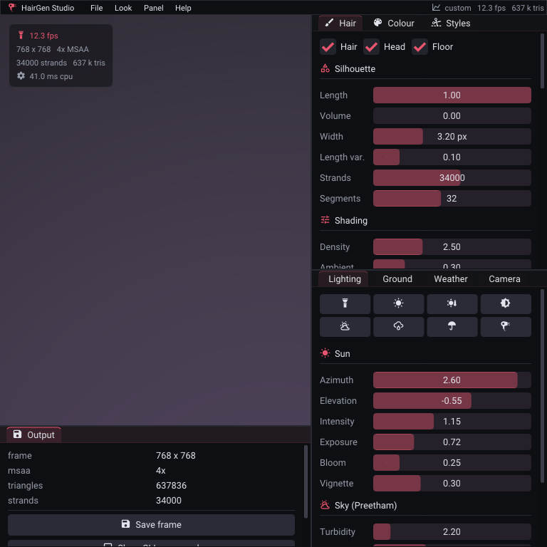 | 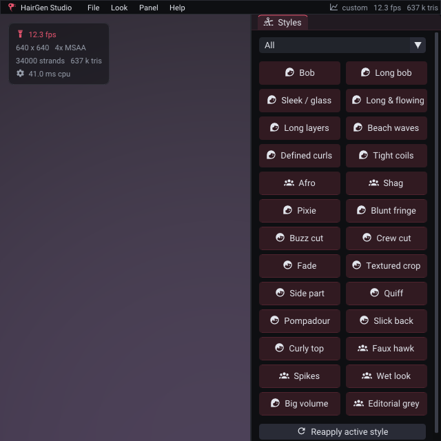 |

There is no window and no swapchain here, so the panel does not use a GPU
backend at all:

* **It is a real ImGui context.** `src/ui.cpp` builds the whole interface -
  `DockSpaceOverViewport` with a passthrough central node so the render shows
  through, and ten dockable, resizable, tabbable, floatable windows: **Hair**
  (silhouette, shading, the full operator stack), **Colour** (palette, root/tip
  pickers, ombre presets, variation), **Styles** (the 26-preset gallery),
  **Lighting** (sun, atmosphere, nine look presets), **Ground** (checkerboard,
  water), **Weather**, **Camera** (with front / ¾ / side / back buttons),
  **Output** (stats, save-frame, "copy CLI command", reset) and **About**.
* **Widget polish on top of stock ImGui**: label-left sliders whose track is a
  filled bar (ImGui paints its knob *under* the value text, so a mid-range value
  is unreadable), right-click-to-reset on every slider, a section-header style,
  a dye palette as a chip grid with hover previews, per-style gendered icons, and
  a CLI echo per window so a look can be reproduced from the shell.
* **The draw lists are rasterised on the CPU** (`src/ui_draw.cpp`): edge-function
  triangles, top-left rule, bilinear font-atlas sampling, straight-alpha "source
  over" - about 250 lines, no graphics API. That keeps the panel working on any
  driver stack (including a headless lavapipe box) and means it costs *nothing*
  on the GPU.
* **Input arrives over HTTP.** `assets/web/studio.js` maps pointer coordinates
  back through the letterboxed image and beacons mouse / wheel / key / text
  events to `GET /ui/input?x=…&y=…&b=…&d=…`, which the server turns into
  `ImGuiIO` events. Motion is coalesced to one packet per 30 ms so a slow render
  cannot build a queue.
* **Fonts and icons.** Roboto (regular + medium) for text and a 10 kB subset of
  Material Design Icons for glyph icons, merged into the atlas with
  `IMGUI_USE_WCHAR32` (the glyphs live above the BMP). `tools/make_icons.py`
  regenerates both the subset TTF and `src/ui_icons.hpp` from `@mdi/font`.
  Everything degrades gracefully: no fonts on disk → ImGui's built-in face.

The HTML page is only the shell (a stage, a status pill and a few buttons) -
every control lives in the dockable panels.

| endpoint | purpose |
|---|---|
| `GET /` | the studio shell (`assets/web/studio.html`) |
| `GET /classic` | the original DOM panel, unchanged |
| `GET /stream` | MJPEG preview of live GPU frames, with the panel baked in |
| `GET /snapshot.png` | single frame as PNG |
| `GET /scene` | camera/hair values as JSON |
| `POST /params` | JSON scene update (used by the classic panel) |
| `GET /ui/input?…` | one panel input event (mouse, wheel, key, text) |
| `GET /ui/toggle` | show/hide the panel; `/ui/quit` stops the server |

**Panel screenshots without a GPU.** `--ui-dump FILE` renders the panel over a
stand-in background and writes a PNG. It needs no Vulkan at all, so it is both
the way `media/stills/panel*.png` are made (`HGEN_UI_FOCUS=colour` photographs
one window) and a zero-dependency smoke test for the UI.

Connections are served on their own threads and the renderer is guarded by a
render mutex, so the sliders keep working while a stream is live.

## Tests

```sh
meson test -C build
# with no GPU at all (the render test then runs on software Vulkan):
tools/softvulkan.sh --prefix /tmp/softvk && eval "$(tools/softvulkan.sh --prefix /tmp/softvk --env)"
meson setup build --reconfigure -Dintegration_render=true && meson test -C build
```

* `test_math` - vector/matrix math, view-projection round trip.
* `test_png` - the PNG writer emits valid IHDR/IDAT/IEND chunks.
* `test_assets` - the bundle has every chunk the renderer needs, with the demo's
  dimensions (7×6×13 hair mesh, 22 bundles, 256² clump map, ≥25 % coverage).
* `test_ubo` - the frame UBO is declared twice (GLSL `FrameBlock` and C++
  `FrameUbo`); the test parses both and fails if the field order, types or the
  704-byte size ever drift apart.
* `test_ui` - the palette round-trips (linear ↔ sRGB ↔ hex, default dye == the
  rosa swatch), the hairstyle catalogue is complete and in range, `cli_command`
  reproduces a scene, and the ImGui panel really draws: four frames over a flat
  buffer, at least five windows docked, and synthetic input reaches the scene.
  It needs no GPU, so it runs everywhere.
* `integration_render` - renders a frame headlessly (on real hardware or on the
  software Vulkan stack, see below), validates the PNG, checks
  the image is not flat, and verifies the hair pass changes ≥10 % of pixels.
  It skips (meson `77`) when no Vulkan device is available.

## Media (pictures, video, GIF)

`python3 tools/capture.py --binary build/hairgen` (`ninja -C build capture`):

| file | contents |
|---|---|
| `media/stills/*.png` | hero shot, 11 dye swatches (incl. ombre / balayage / dip dye), 26 hairstyles, 4 ground/checker variants, 4 look presets, 4 lighting setups, 6 control sweeps, 5 mode stills, 8 weather stills |
| `media/stills/panel*.png` | the dockable ImGui panel, whole and per window (rendered by `--ui-dump`, no GPU needed) |
| `media/stills/mode_*.png` | lines vs ribbons, root samples, hair-mesh cage, no-collide |
| `media/mode_comparison.png` | the four modes side by side |
| `media/hero_1536.png` | 1536² hero render |
| `media/contact_sheet.jpg` | 12-up overview (hero + dye palette + hairstyles) |
| `media/dye_sheet.jpg` | the full dye palette on one sheet |
| `media/model_sheet.jpg` | Unreal's Hair shading model at the ends of each documented input (roughness, specular, scatter, backlit, physical vs stylised) |
| `media/aa_off.png`, `media/aa_on.png` | 1× vs 4× MSAA |
| `media/weather_sheet.jpg` | dry / drizzle / rain / storm / sunset / noon / puddles / close-up |
| `media/rain.gif`, `media/rain.webp`, `media/rain.avi` | the rain system in motion |
| `media/orbit.gif` | 40-frame animated GIF (480², 20 fps) |
| `media/orbit.avi` | MJPEG video of the same animation |
| `media/animation_strip.png` | 6 frames from the turntable |
| `media/hair_shading_sweep.mp4` | **hair shading sweep**: a full 360° sun orbit around the bust, 40 frames at 14 fps, so the two specular lobes, the scatter and the backlit transmission can be followed across the mass (see below) |
| `media/hair_shading_sweep.gif` | the same clip as a looping GIF |
| `media/hair_shading_sweep.jpg` | four frames of it as a filmstrip |

## Layout

```
src/            main.cpp (CLI), renderer.{hpp,cpp}, vk_util (device/queues/images/
                pipelines/descriptors), vk_loader (runtime loader + ICD scan),
                assets (bundle reader), png (writer), web (preview server), math,
                scene.hpp (parameters, dye palette, hairstyle catalogue),
                ui.{hpp,cpp} (the dockable ImGui panel), ui_draw.cpp (its CPU
                rasteriser), ui_icons.hpp (generated icon codepoints)
shaders/        GLSL 450 sources + lib/common.glsl, lib/shadow.glsl,
                lib/hair_shading.glsl, lib/sky_model.glsl (Preetham),
                lib/sky.glsl (clouds + rain veil)  ->  src/shaders_generated.hpp
                (edit a shader, then `ninja -C build shaders && ninja -C build`;
                 the `shaders-check` target fails the build on a stale header)
tools/          export_assets.js, compile_shaders.py, capture.py, make_icons.py,
                softvulkan.sh (CPU Vulkan for headless/CI rendering)
tests/          unit + integration tests (meson)
assets/         hairgen_assets.bin, fonts/{Roboto-Regular,Roboto-Medium,
                MaterialDesignIcons-Subset}.ttf, web/{studio,index}.html,
                web/{studio,style}.css, web/{studio,app}.js
third_party/    vulkan headers, miniz, imgui (1.91.8-docking: core only)
media/          rendered deliverables
```

Regenerate shaders with `ninja -C build shaders` (needs `glslangValidator` on
`PATH` or in `tools/bin/`, e.g.
`npm pack glslang-validator-prebuilt-predownloaded`) and the asset bundle with
`ninja -C build assets` (needs node). The icon font is regenerated with
`python3 tools/make_icons.py --mdi <@mdi/font package> --ttf
assets/fonts/MaterialDesignIcons-Subset.ttf --header src/ui_icons.hpp` (needs
`fonttools`); the text fonts are plain Roboto TTFs from `roboto-fontface`,
converted from WOFF with `fontTools`.

Dear ImGui is vendored (docking branch, core only, no backends): `imgui.cpp`,
`imgui_draw.cpp`, `imgui_tables.cpp`, `imgui_widgets.cpp` plus the headers, and
`imconfig.h` sets `IMGUI_USE_WCHAR32` for the icon codepoints.

## Render graph

```
hair shadow map (1024²) ─┐
object shadow map (1024²)┼─> scene pass (4× MSAA, RGBA16F) ─> resolve
sky LUT bake (256×128) ──┘        │  sky · ground · head · hair
                                  ├─> bloom prefilter (¼ res)
                                  ├─> bloom blur ×2 separable
                                  └─> post: bloom add, exposure, ACES,
                                             vignette, sRGB, dither ─> PNG
```

## Notes / differences from the web demo

* The demo shades straight into sRGB and multiplies by `REAL_INTENSITY = 5`
  followed by a `sqrt()`. Here the scene is linear HDR with the same fiber
  radiance (`REAL_INTENSITY` folded into exposure) and the demo's `sqrt` is
  replaced by a proper ACES tonemap, so the highlights on blond hair roll off
  instead of clipping to white.
* The demo has no background or floor; both are new (baked sky + shadow-catching
  ground plane), as is the bloom/tonemap chain.
* The demo's cloud pass sampled the 32³ noise volume directly, which reads as
  large trilinear blobs at sky scale; the deck here uses gradient-noise FBM
  (ported from three.js' `Sky.js`) with Beer/powder shading and a silver lining.
* `july_colliders.js` is consumed by the demo's physics solver, which is itself
  disabled (`simulator.init()` returns immediately). Here the same spheres are
  applied as a push-out in the hair vertex shader, so they also affect the
  static render.
* `july_rootsamples.js` holds one root per strip (the demo draws at most 1 000).
  Above that, roots are reused cyclically with a small per-strand offset, which
  keeps the demo's root distribution while allowing dense renders.
* The ImGui panel is new (the demo drives WebGL uniforms from a DOM form). It
  is a real docking workspace, but it cannot use ImGui's OpenGL/Vulkan backends
  here: the renderer has no window, so the draw lists are rasterised on the CPU
  into the frame that is streamed to the browser (`src/ui_draw.cpp`).
* The `HGEN_SKIP=passname ...` environment variable skips render passes
  (`background`, `grounddraw`, `headdraw`, `hairdraw`, `rain`, `simplesky`) and
  is handy when bisecting driver problems. `HGEN_DBG=N` replaces the head
  shading with a debug channel (11 ao, 13 normal map, 20 world normal, 22
  albedo, 31 ambient, 32 diffuse, 33 specular, 38 geometric normal, ...).
* `HGEN_NOCULL=1` draws the head two-sided. The default culls back faces, which
  is safe now that the exporter orients every triangle against the supplied
  shading normals; before that fix the scan's folds were drawn inside-out and
  shaded as dark wedges across the face.
* `head.idx` is stored as **u32** in the bundle and the loader must be told so:
  the chunk carried u32 data but was declared u16, so every index was read as
  two halves and the head came out shredded (long thin shards off the
  silhouette, a "flap" across the cheek, smeared shading). `tests/test_assets`
  now pins the format and checks every index is in range.
* One llvmpipe quirk worth knowing: a fragment shader that `discard`s inside an
  alpha-blended, 4× MSAA pass corrupted whole tiles on lavapipe. The rain pass
  therefore writes alpha 0 instead of discarding, which is a no-op under the
  blend function it uses.

### The hair shading sweep

```sh
tools/softvulkan.sh --prefix /tmp/softvk && eval "$(tools/softvulkan.sh --prefix /tmp/softvk --env)"
./build/hairgen --sequence frames --frames 40 --fps 14 --anim light \
    --size 288 --samples 4 --ssaa 2 --shadow-res 2048 \
    --hair-count 18000 --segments 24 --width-px 2.0 \
    --dye honey --dye-strength 0.7 \
    --sun-rot 1.6 --sun-tilt -0.45 --rot 2.9 --dist 2.6
```

`--anim light` walks the sun once around the head at 9° per frame. What to look
at, in order: the tight **light-coloured** lobe and the broad **fibre-tinted**
lobe splitting as the sun crosses the strands (UE's two-lobe Hair model, see
above); the mass *brightening* rather than going black when the sun is behind
it (the dual-scattering/Scatter term); the glow at the silhouette (Backlit);
and the contact shadow of the whole mass on the checkerboard.

| | | | |
|---|---|---|---|
| 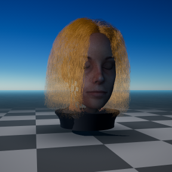 | 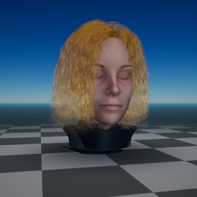 | 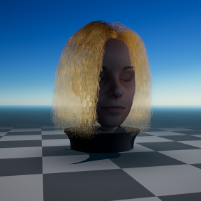 | 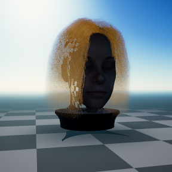 |

## Rendering on a machine with no GPU

`tools/softvulkan.sh` assembles a CPU Vulkan stack, so the renderer runs on a
build box or in CI exactly as it does on a GPU:

```sh
tools/softvulkan.sh --prefix /tmp/softvk          # once, ~1 min
eval "$(tools/softvulkan.sh --prefix /tmp/softvk --env)"
./build/hairgen --list-devices
#   - llvmpipe (LLVM 23.1.3, 256 bits) (cpu, api 1.4.354, software)
./build/hairgen --out render.png --size 320 --samples 4 --ssaa 2
```

Two pieces are needed and neither is usually installed: the Khronos **loader**
(portable C, built here from source with CMake) and a **software ICD** - Mesa's
**lavapipe** by default, SwiftShader with `--icd swiftshader`. Both are pulled
from npm packages that ship them (`@drawcall/webgl-linux-x64` and
`@onirenaud/swiftshader-vulkan`), which is what makes this work in a container
with no distro packages available.

The delivered turntable/sweep media is rendered this way. On 2 vCPUs (llvmpipe,
18k strands x 24 segments, 4x MSAA + 2x SSAA) a 288^2 frame takes ~13 s and a
384^2 frame ~25 s - slow, but it is the real pipeline rather than a mock, and it
means the render path is testable without a GPU at all.
